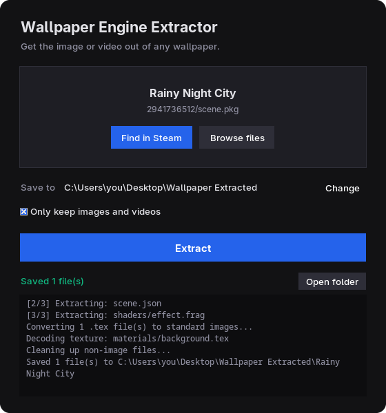

# Wallpaper Engine Extractor

Get the actual image or video out of any Wallpaper Engine wallpaper. Point it at your Steam Workshop folder, pick a wallpaper, click extract. You get a normal PNG/JPG/MP4.

**[⬇ Download WallpaperExtractor.exe](https://github.com/uKeps/wallpaper-engine-extractor/releases/latest)** · single file, no install, no Python needed

<p align="center"></p>

## Why this one

Workshop wallpapers come packed as `scene.pkg` archives with textures in Wallpaper Engine's own `.tex` format, so you can't just open them. [RePKG](https://github.com/notscuffed/repkg) is the well-known tool for this, but it's command line only. This one adds:

- **A GUI**, with drag and drop
- **Auto-detection** of every installed wallpaper via Steam, with thumbnails, so there's no digging through numbered folders
- **Video wallpapers** (`.mp4`/`.webm`) handled in the same place
- **"Images only" mode** that throws away shaders, scripts and JSON and keeps just the wallpaper
- **A CLI too**, if you'd rather script it

## Usage

1. Open `WallpaperExtractor.exe`
2. Click **Find in Steam** and pick a wallpaper, or drop a `scene.pkg`, `.tex` or video file onto the window
3. Click **Extract**, then **Open folder**

Files go to `Wallpaper Extracted` on your Desktop unless you change it. "Images only" is on by default, so you get just the wallpaper, not its shaders and scripts.

Web-type wallpapers show up in the list but can't be extracted, they don't have a fixed asset to pull.

## Windows warnings

The exe isn't code signed (a certificate costs money every year, hard to justify for a free tool), so Windows treats it as coming from an unknown publisher.

- **Blue "Windows protected your PC" screen:** click **More info → Run anyway**.
- **Blocked by Smart App Control, no "run anyway" option** (some Windows 11 installs): run from source instead, see [below](#running-from-source). Don't disable Smart App Control for this, turning it back on means reinstalling Windows.

Each release ships a `checksums.txt` to verify the download: `Get-FileHash WallpaperExtractor.exe -Algorithm SHA256`.

## Running from source

Needed for the CLI, on Linux, or when the exe is blocked. Requires [Python 3.10+](https://www.python.org/downloads/) (check "Add Python to PATH" during install).

```bash
git clone https://github.com/uKeps/wallpaper-engine-extractor.git
cd wallpaper-engine-extractor
pip install -r requirements.txt   # optional, see below
python main.py                    # opens the GUI
```

`pip install` is optional. Without it, PNG/JPG textures still extract fine, RAW textures fall back to BMP, and drag & drop is disabled.

### CLI

```bash
# list installed wallpapers (title, ID, type, asset path)
python main.py --list-wallpapers

# extract, outputs to scene_extracted/ next to the .pkg
python main.py "path/to/scene.pkg"

# custom output folder
python main.py "path/to/scene.pkg" -o "C:/Users/YourName/Desktop/output"

# a standalone .tex file or a video wallpaper works the same way
python main.py "path/to/texture.tex" -o out
python main.py "path/to/video.mp4" -o out
```

```
positional arguments:
  input                 Path to scene.pkg, a standalone .tex file, or a video wallpaper (.mp4/.webm)

options:
  -h, --help            Show this help message and exit
  -o, --output PATH     Output directory (default: <name>_extracted next to input)
  --no-tex-convert      Skip converting extracted .tex files to PNG/JPG
  --all-mipmaps         Extract all mipmap levels, not just the highest resolution
  --no-cleanup          Keep all extracted files (shaders, JSON, scripts, etc.)
  --gui                 Force launch the GUI even when arguments are provided
  --list-wallpapers     List installed Wallpaper Engine Steam Workshop wallpapers and exit
```

## Where the files live

You normally don't need this, auto-detection finds them. But if you want to look manually:

```
C:\Program Files (x86)\Steam\steamapps\workshop\content\431960\<wallpaper_ID>\
```

| File | What it is |
|---|---|
| `scene.pkg` | Package with the wallpaper's assets |
| `preview.jpg` | Preview thumbnail |
| `project.json` | Wallpaper metadata |

## How it works

**`.pkg`**: binary archive. Root path string (`PKGV0024`-style, identifies the WE version), a uint32 file count, then entries (name, offset, size), then all file data concatenated.

**`.tex`**: three sections, `TEXV` (version), `TEXI` (width/height), `TEXB` (mipmap data). Each mipmap has width, height, size and image bytes. Instead of hardcoded offsets, which break between format versions, the parser scans for the `(width, height)` byte pattern right after `TEXB` to find the first mipmap.

**Video**: no `.pkg` involved, the `.mp4`/`.webm` already sits loose in the Workshop folder. "Extracting" is just a copy.

## Building the executable

```powershell
.\build.ps1
```

Installs PyInstaller if needed, writes `dist\WallpaperExtractor.exe` (~17 MB, single file, no console). Python, Tk, Pillow and the `tkdnd` Tcl package all get bundled in.

Pushing a `v*` tag builds it on GitHub Actions and attaches the exe plus `checksums.txt` to the release (`.github/workflows/build.yml`). Can also be run manually from the Actions tab.

Builds are unsigned. [SignPath Foundation](https://signpath.org/) gives free signing certs to open source projects that build in public CI, that's the only route that clears SmartScreen and Smart App Control without paying yearly.

## Disclaimer

For personal use, like recovering the image of a wallpaper you already own. Respect creators' copyright, don't redistribute extracted assets without permission.

## License

[MIT](LICENSE) © uKeps
